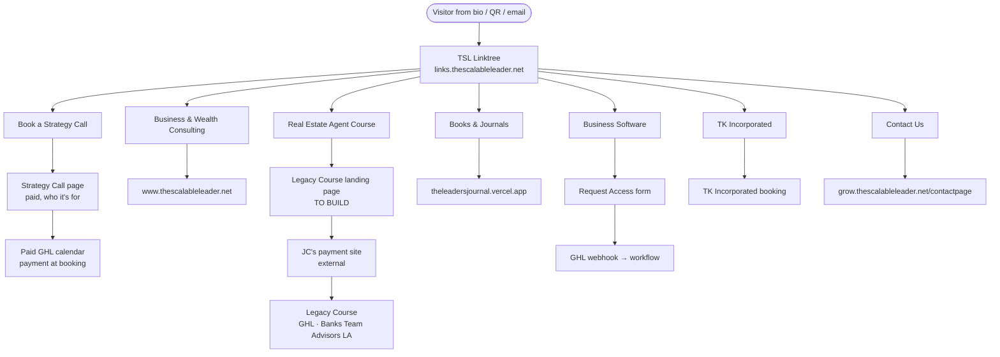

---
tags:
  - project
  - blueprint
status: draft
updated: 2026-11-07
---

> **Note 2026-11-17:** the linktree is now GHL-based. Hosting in section 5 (Vercel) is superseded; see `PROJECT-NOTES.md` for the current status.

# TSL Linktree — Blueprint

How the linktree works, what each tab is for, and what's left to build. Working document: update it as each piece is finished.

Build notes and history: TSL Linktree

**JC questionnaire + tap-through simulation:** `Projects/TSL/Linktree Blueprint for JC/TSL-Linktree-Blueprint.html` (37 questions; JC downloads answers as a .txt and sends it back). Keep sections 3–7 here in sync with it.

---

## 1. What the linktree is for

One address JC can put in every bio, email signature and QR code. Each tab sends a visitor to **one clear next step**: book, buy, learn, or get in touch.

**Address:** `links.thescalableleader.net` (planned; see section 5)

## 2. How it fits together



## 3. The tabs

| # | Tab | Purpose | Goes to | Status | To finish |
|---|---|---|---|---|---|
| 1 | **Book a Strategy Call** (featured) | Private 1-hour paid session ($350), so only serious prospects book | `strategy-call.html` → GHL calendar **TSL Consulting Call** (same as thescalableleader.net/book-consulting.html) | 🔵 Page built; calendar works | JC to approve copy; build the booking workflow in GHL (section 4a) |
| 2 | Business & Wealth Consulting | JC's coaching and consulting offer | `www.thescalableleader.net` | 🟢 Live, confirmed by JC | None. On the site: **Book a call (paid)** or **Apply** (saved and tagged in GHL, plus an acknowledgment email). Both already automated by JC |
| 3 | Real Estate Agent Course | Sell the Legacy Course | Currently the 5 Shifts ebook page (wrong) → **Legacy Course marketing page** with Enroll button | 🟠 Mislinked | Legacy page (section 4b); JC picks the access setup |
| 4 | Books & Journals | Books and journals, bought on Lulu | `theleadersjournal.vercel.app` | 🟢 Live, confirmed | Add the finished RVPT; feature the Journal + RVPT at the top of that site; find where its code lives |
| 5 | Business Software | Introduce the software to high-end family businesses; collect access requests | Business Software page (section 4c) with the Request Access form → GHL | 🟡 Form built | JC answers the page questions; which sub-account gets the leads |
| 6 | TK Incorporated | Booking for TK Incorporated | **JC's own landing page — JC builds it**, we only link the tab | ⚪ Waiting on JC | JC uses the DIY kit in the blueprint file, then sends the page link |
| 7 | Contact Us | General enquiries | `grow.thescalableleader.net/contactpage` | 🟢 Live | None |
| — | Social row | YouTube, Instagram, email | Banks Team channels, `support@` | 🟢 Live | Confirm these are the channels JC wants under TSL |

## 4. Real Estate Agent Course → Legacy Course

**What we know**
- The course is **Legacy Course** in GHL, sub-account **The Banks Team Advisors LA**. It has 6 members and 5 modules, and starts with *Phase 1: Building Your System (Marketing & Operations)*.
- The same courses also exist in **The Banks Team Advisors TX**.
- Payments do **not** run through GHL. JC's own sites and software take payments and subscriptions, and GHL only delivers the course.
- Related courses in LA: **LEGACY TOOL KIT** (0 members) and **Agency Accelerator Course** (0 members).

**The journey to build**

```
Linktree tab → Legacy landing page → Enroll button → JC's payment site → access to the course in GHL
```

**Landing page: proposed sections**

1. Hero: who it's for and the outcome, with the TSL contrast headline
2. The problem agents face
3. What's inside: the 5 phases, from the GHL outline
4. Who JC is: credibility
5. What you get: lessons, quizzes, DISC assessment, live sessions
6. Testimonials, if any exist
7. FAQ
8. Enroll button → JC's payment page

**Recommended home:** inside the linktree site, at `links.thescalableleader.net/legacy`. It gets the same premium look, the same hosting, and no extra funnel.

**Needed before building**
- [ ] Address of JC's payment page for Legacy
- [ ] How a buyer gets into the GHL course after paying (automatic or manual)
- [ ] LA or TX? Which sub-account does a new buyer go into, and does it depend on their state?
- [ ] Full module list (screenshot of the outline, all 5 modules expanded)
- [ ] Price and what's included (or leave the price off the page)
- [ ] Testimonials and JC's bio or credentials
- [ ] Should the Tool Kit and Agency Accelerator be on the page, or kept for later?

## 4a. Strategy Call — GHL setup

| Piece | Status | Detail |
|---|---|---|
| Calendar **TSL Consulting Call** | ✅ Exists | 1 hr, $350 taken at booking. Check rescheduling is on and JC is host |
| Workflow **TSL Strategy Call – Booked** | To build | Trigger: appointment booked in that calendar → tag `strategy-call-booked` → confirmation email now → wait until 1 day before → SMS reminder |
| Texting | Check | Sub-account texting number must be A2P-registered; booking form must collect phone |

Build the workflow with GHL's AI workflow builder, using the prompt in the blueprint file (Strategy Call tab → "How it's set up in GHL"). Review every step before publishing.

## 4b. Legacy Course page — sub-blueprint

Lives at `links.thescalableleader.net/legacy`, same look as the linktree.

| # | Section | Content source |
|---|---|---|
| 1 | Hero: headline, promise, Enroll | JC: who it's for, biggest result |
| 2 | The problem | JC: 3 biggest struggles of agents |
| 3 | What's inside: 5 phases | GHL course outline (LA) |
| 4 | Your teacher | JC's bio |
| 5 | Results | Testimonials |
| 6 | The offer | Price/plan, what's included, Tool Kit / Agency Accelerator decision |
| 7 | Guarantee + FAQ | JC |
| 8 | Final Enroll | — |

**Access setup (JC picks one):** All in GHL (recommended: checkout + automatic access) · his payment site connected to GHL · his payment site with access added by hand.

## 4c. Business Software page — sub-blueprint

| # | Section | JC answers |
|---|---|---|
| 1 | Hero | What best describes the software |
| 2 | Who it's for | High-end family businesses |
| 3 | The problem | What families deal with today |
| 4 | What makes it different | vs the market |
| 5 | The software | Each product + one line |
| 6 | Privacy and trust | How family data is protected |
| 7 | Request access | Form already built; access: invite-only / waitlist / open |

## 4d. TK Incorporated — JC builds it

Not built by glez. The blueprint file gives JC a 4-step kit and an AI page-builder prompt that fills in from his answers. When his page is live he sends the link and we point the tab to it.

## 5. Hosting and ownership

| Piece | Where | Owner |
|---|---|---|
| Code | This GitHub repo | glez builds |
| Hosting | JC's Vercel | JC |
| Address | `links.thescalableleader.net`, CNAME in JC's GoDaddy | JC |
| Leads and courses | GHL sub-accounts | JC |

**Old addresses to clean up:** the GHL copies at `grow.thescalableleader.net/linktree`, `/links-page` and `/links-6822`. Full map in the repo's `HOW-TO-USE.md`.

## 6. Build order

| Phase | Work | Blocked on |
|---|---|---|
| **1. Fix what's live** | Strategy Call calendar link; re-point the Real Estate tab | TSL calendar link; decision on the temporary link for tab 3 |
| **2. Hand over to JC** | Mirror to JC's GitHub, JC's Vercel, `links.` subdomain, GoDaddy NS cleanup | JC's GitHub username; GoDaddy Delegate Access |
| **3. Legacy landing page** | Design and build `/legacy` | Items in section 4 |
| **4. Business Software live** | Webhook into the right sub-account, workflow, test lead | Which sub-account; what the software is |
| **5. TK Incorporated** | Real booking link | What TK Incorporated is |
| **6. Retire old addresses** | Redirect `/linktree`, delete the `/links-6822` step | Phase 2 done |

## 7. Open questions

1. What is **TK Incorporated**: one of JC's businesses, or a partner?
2. What is the **Business Software**, and which GHL sub-account should its leads land in?
3. Until the Legacy page exists, should tab 3 be hidden, or temporarily point to JC's payment page?
4. Do the social links (Banks Team channels) belong on the TSL linktree, or should TSL have its own?

## 8. Parking lot

- LEGACY TOOL KIT as an upsell on the Legacy page
- Agency Accelerator Course as its own tab later
- Separate pages for TX and LA, if pricing or licensing differs by state

---

## JC's answers — 2026-11-07

Source: `Projects/TSL/Linktree Blueprint for JC/TSL-Linktree-answers-from-JC.txt`. These override sections 3–7 where they differ.

**Tab order (JC):** Book a Strategy Call (featured, top) · Business & Wealth · Books & Journals · Business Software · RE Agent Course · KFTK Inc · Contact Us. ✅ Applied (commit 022f61a, not pushed)

| Area | Decision | Status |
|---|---|---|
| Strategy Call | $350/1 hr, TSL Consulting Call calendar, JC hosts, confirmation email + SMS day before: all approved | Workflow still to build in GHL |
| Strategy Call | Reschedule allowed up to **2 hours before**; say so on the page | ✅ Page copy. GHL calendar cutoff setting still to set |
| Strategy Call | Booking question: focus area — leadership, organization or wealth development | ✅ Page copy. Field still to add to the GHL booking form |
| Consulting | Subtitle → "Consulting and coaching"; tag linktree leads in GHL | ✅ Subtitle. Tag still to set up |
| Headline | "Build wealth. Grow your business. Create lasting impact." approved | ✅ Searched 2026-11-07: no exact match online |
| RE Agent Course | Buyers go to JC's GHL funnel `sites.leadconnectorhq.com/preview/zDHvksHY8ljitDR7mtf5`; sub-account **Banks Team Advisors TX** (legacycoachingco.com) | ✅ Tab points there for now. Final: the new Legacy funnel we build |
| Legacy page | $197 one-time · Tool Kit as a bonus · money-back guarantee (14 days in small print) · 5 phases from GHL | Content R&D: course in GHL, TBTA-TX email + SMS campaigns, JC's 2 Google Docs, testimonial on his funnel |
| Books & Journals | New **subdomain** with lanes: Regal book · journals (org, leaders, wealth — coming soon) · RVPT curriculum | R&D. Top-of-page and RVPT buying: not answered |
| Business Software | Visitors start at `app.thescalableleader.net/intake` (the app's own Request Access page); demo at `/demo`, audit at `/audit`. Glez follows up. AI assistants = v2, separate tier | ✅ Tab points to /intake. Our `request-access.html` is now unused |
| Business Software page | JC gave full copy: differentiator, family-business angle, problem, privacy (RLS audited, no bank connections, QuickBooks only, private accounts) | Page not built. Exclusivity: not answered |
| KFTK Inc | Formerly TK Incorporated. Kings For The Kingdom, ministry. Enquiry: speaking, curriculum, Regal book package. Subtitle "Faith-based opportunities" | ✅ Title + subtitle. Link TBD → placeholder still in the card |
| Contact Us | Email, phone, contact form; support@thescalableleader.net confirmed | ✅ Subtitle. Existing contact page already has email + phone |
| Address | `links.thescalableleader.net` approved | GoDaddy Delegate Access: not answered |
| GitHub | JC: use the account glez already has access to | Done: this repo |
| Social icons | Banks Team YouTube + Instagram: JC left it to Glez | Our decision |
